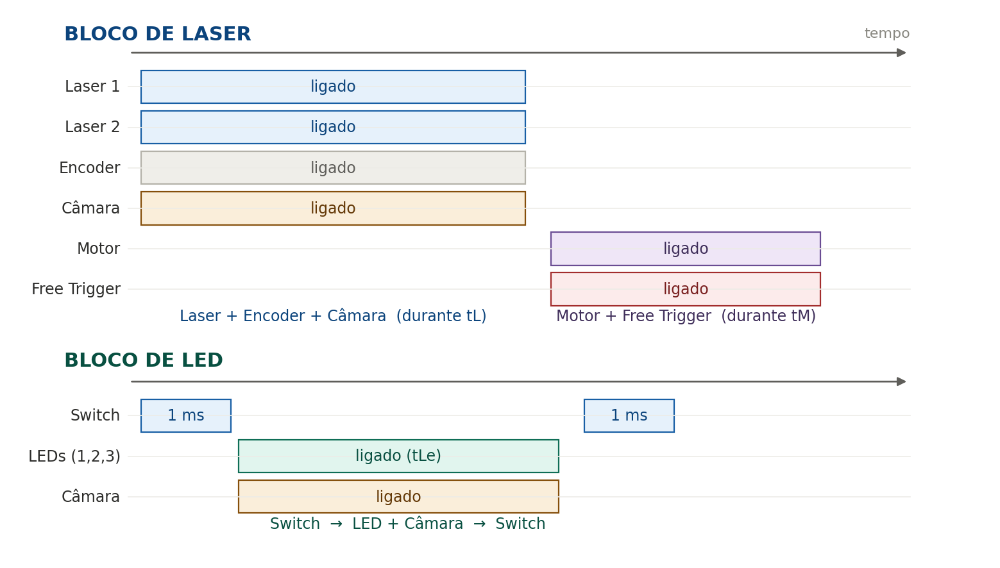
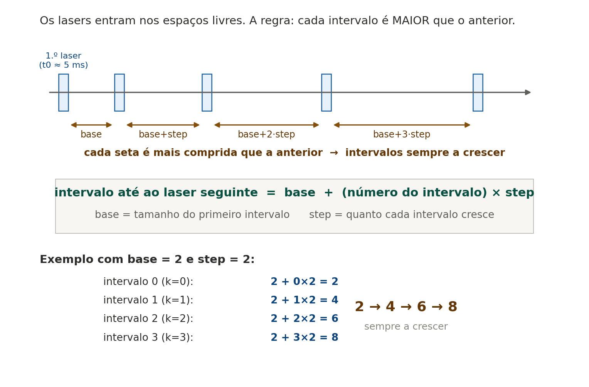
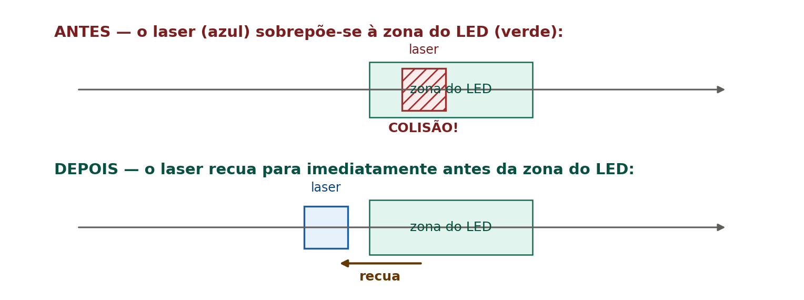
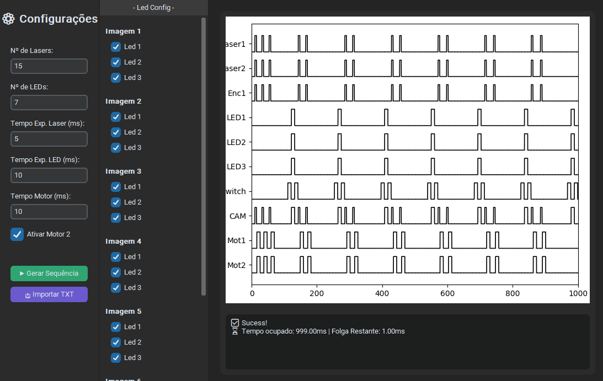
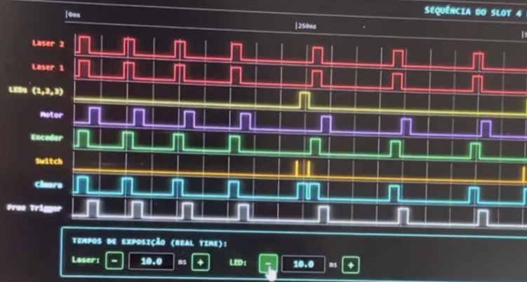
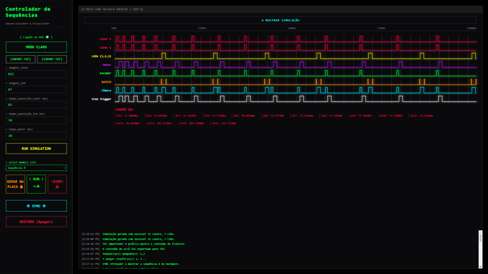

# Structured Light System, underwater vision

**Real-time control of structured lighting for autonomous underwater vehicles.**

Six-month curricular internship at **INESC TEC, Autonomous Systems Laboratory (LSA)**, Porto,
February to July 2026, for the BSc in Electrical and Computer Engineering at ISEP.

> **Documentation only.** This system belongs to INESC TEC. No source code, no communication
> protocol internals and no memory maps are published here. What follows describes the engineering
> problem and the approach, at the level of the public internship report.

---

## The problem

Water destroys images. It absorbs light unevenly across the spectrum, and particles in suspension
scatter the light back into the camera before it ever reaches the scene, washing everything out.
That backscatter is the reason a bright lamp on a submersible often makes the picture worse, not
better.

Structured lighting attacks this by not lighting everything at once. Line lasers and white LEDs are
fired in short, precisely placed pulses, synchronised with the camera shutter, so the camera is
only open when the useful light is in frame.

That synchronisation is the whole problem. The light has to fire at the right microsecond, every
second, forever, on a vehicle that has no operator standing next to it.

---

## The system

A board built around an **STM32F415** (Cortex-M4 @ 168 MHz) running **FreeRTOS** drives the lasers,
LEDs, camera trigger and a positioning motor. A host computer configures it over **RS-485**, chosen
for its differential signalling: an underwater vehicle is full of motors and high-power equipment,
and a single-ended line would not survive the electrical noise.

The lab already had a firmware base for this board. The first task was reading it: how the FreeRTOS
tasks were laid out, how serial reception worked, how the timers drove the output pins. Everything
below was built on top without disturbing what already worked.

---

## 1. The sequencing algorithm

Given a number of laser shots and a number of LED shots, place them inside a closed **1000 ms**
cycle while satisfying seven constraints at once:

| | Constraint |
|---|---|
| R1 | The cycle always opens with a laser |
| R2 | LED shots are spaced exactly evenly, at 1000/n apart |
| R3 | Intervals between consecutive laser shots are strictly increasing |
| R4 | The wrap-around gap, last laser to first laser of the next cycle, is the largest of all |
| R5 | No laser block ever overlaps an LED block |
| R6 | Collision resolution moves whole blocks; pulse widths are never altered |
| R7 | No event passes 999 999 µs |

**LEDs are placed first**, because their rule is rigid. The cycle is cut into equal slices, one per
LED, and each LED sits at the end of its slice. Each LED travels inside a block, with a switch
pulse before and after it and safety margins around them. That block is a forbidden zone: a laser
firing inside it would saturate the camera.

**Lasers are then fitted into what is left.** Rather than computing each position independently,
the intervals follow a simple growth rule with two parameters, a base and a step, which satisfies
R3 and R4 by construction instead of by checking afterwards.

Where an ideal laser position lands inside a forbidden zone, the whole block is shifted clear,
keeping its duration intact.

The strategy was explored first in a **Python prototype** (CustomTkinter for the inputs, Matplotlib
for the waveforms), purely to reason about the problem on paper before committing anything to
firmware.

---

## 2. Deterministic execution

Sequences are not executed by software delays, which would block the processor and accumulate
error. Execution rides on a **32-bit hardware timer**:

- the prescaler divides the 84 MHz peripheral clock down to **1 MHz**, giving the counter a
  **1 µs** resolution
- the auto-reload value makes the counter roll over at exactly **1 000 000** counts, one second
- a compare channel fires an interrupt at the instant of the next step

At each compare interrupt the service routine writes the step's action word **atomically** into the
GPIO set/reset register, switching every pin involved in a single clock cycle, then programs the
compare value for the following step. A 32-bit timer is not optional here: a 16-bit counter
saturates at 65 535 µs, nowhere near a one-second cycle.

---

## 3. Persistent storage, and protecting the hardware

Twelve independent sequences are stored in Flash so the board runs standalone after configuration.

Flash cannot rewrite a bit from 0 to 1 without erasing the whole sector, and all twelve slots share
a sector. Erasing one slot would take its neighbours with it, so clearing a slot copies the
survivors to a backup sector, erases the main one and copies back only what should remain.

**The safety sequence matters more than the storage.** Erased Flash reads back as `0xFF`. If the
execution routine stayed live during an erase, it would read those bytes as a valid action word
meaning *turn everything on*, and hold high-power lasers and LEDs lit continuously for several
seconds, with a real risk of destroying them.

So before any write: force every output pin low in one instruction, suspend execution, then erase,
write, and only then resume.

This was not theoretical. During exposure-time testing the system was pushed far enough that a LED
overheated and desoldered itself. It was repaired, and it became the clearest lesson of the
internship: the software, not the operator, has to enforce the limit.

---

## 4. Live exposure adjustment

The feature that took the most thought. An operator wants to correct laser and LED exposure times
**while the sequence is running**, see the result on the hardware immediately, and leave the stored
sequence untouched.

The conflict is direct: the interrupt executes steps read from memory, and the requirement forbids
touching Flash. So the new timings have to live in RAM, and they have to appear without the
interrupt ever reading a half-written sequence.

**Solution: double buffering in RAM.**

1. On start, the sequence is copied from Flash into the active buffer, and the interrupt reads RAM
   from then on.
2. An adjustment is recalculated into the *inactive* buffer, by a normal-priority task, never
   inside the interrupt.
3. The swap is signalled only once the new buffer is complete, and happens at the **start of the
   next cycle**.

The interrupt therefore never reads a buffer mid-rewrite. And because the swap is signalled by
completion rather than scheduled for a fixed cycle, a recalculation that overran would simply mean
the old buffer plays for one more cycle. No inconsistent state exists at any point. Stopping
execution discards the adjustment; the stored sequence is provably unchanged.

Not every adjustment is physically possible, so values are validated in two layers and reverted,
with the operator notified, when an adjustment would overrun the cycle or collide with another
event.

---

## 5. Interface

A **React** dashboard (built with Vite) renders the timing diagram live as **SVG**, manages the
twelve memory slots visually, and offers local simulation, import and export. React suits the
problem because the view has to track twelve slot states, the sequence parameters and a graph that
redraws on every adjustment.

A browser cannot open a serial port, so a middle layer bridges the two.

---

## 6. Node.js to ROS

The first bridge was a **Node.js** middleware over HTTP. It worked, but it sat outside the software
the lab actually runs.

It was replaced by a native **ROS node in C++**, with the browser connected through `rosbridge`
over WebSocket. The system is now exposed as ROS command and state topics, which means it drops
straight into the stack running on the LSA's vehicles instead of being a separate tool somebody has
to remember to launch.

---

## What is still open

Stated plainly, because the report does:

- **Exposure limiting in software** is the top priority, and the direct lesson of the desoldered
  LED.
- **Rigorous timing characterisation with an oscilloscope** has not been done. Timing was verified
  against the reconstructed diagrams and the hardware, not instrumented end to end.
- **Testing underwater.** Everything so far is bench work.

---

## Stack

C · FreeRTOS · STM32 · RS-485 · ROS (C++) · React · Vite · Node.js · Python

---

## Context

- **Host:** INESC TEC, Autonomous Systems Laboratory (LSA), Porto
- **Supervisor:** Eng. Eduardo José Pinto Soares (ISEP / INESC TEC)
- **Period:** February to July 2026, six months
- **Degree:** BSc in Electrical and Computer Engineering, ISEP

---

## Contact

João Carlos Caio Ferreira
[joaoccf1723@gmail.com](mailto:joaoccf1723@gmail.com)
